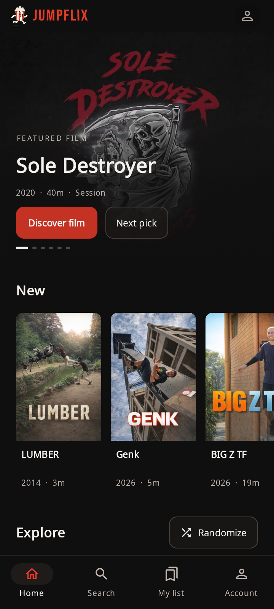
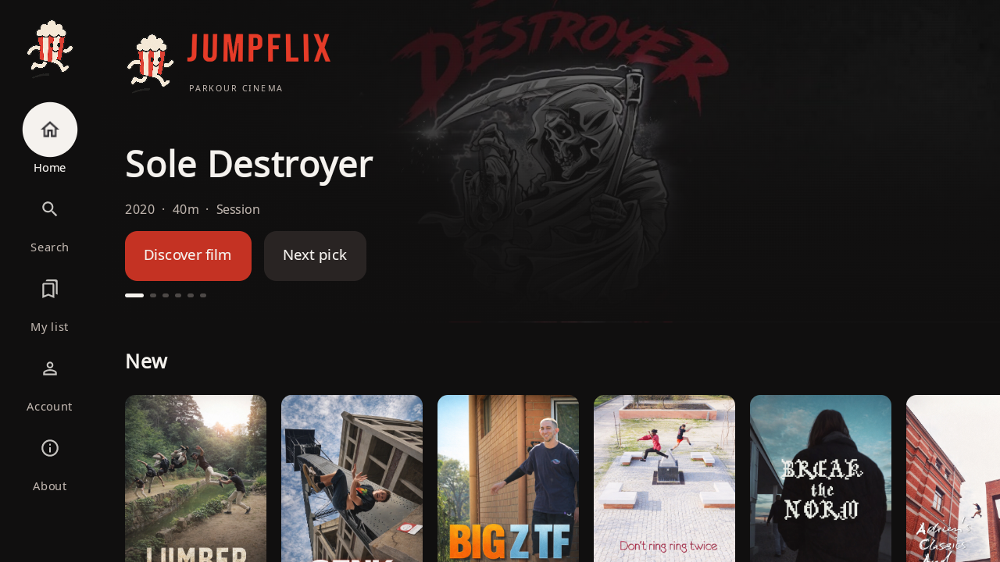

<p align="center">
  
</p>

<h1 align="center">JUMPFLIX for Android</h1>

<p align="center">The parkour film archive, with a native app for Android phones and Android TV.</p>

<p align="center">
  <a href="https://github.com/m-a-x-s-e-e-l-i-g/jumpflix-android/actions/workflows/android.yml"></a>
  
  <a href="https://github.com/m-a-x-s-e-e-l-i-g/jumpflix-android/releases"></a>
  <a href="LICENSE"></a>
</p>

<p align="center">
  <a href="https://www.jumpflix.tv">Website</a> ·
  <a href="https://github.com/m-a-x-s-e-e-l-i-g/jumpflix-android/releases">Download APK</a> ·
  <a href="https://github.com/m-a-x-s-e-e-l-i-g/jumpflix-android/issues">Report an issue</a>
</p>

## What it does

- Browse parkour films, documentaries, and series with portrait posters and daily featured picks.
- Continue watching, save your list, and see which films you've already watched.
- Search by film, filmmaker, athlete, song, or soundtrack artist.
- Explore creator and athlete profiles, video spots, and credited songs.
- Sign in with your existing JUMPFLIX account or Google for XPOP, stats, ratings, and reviews.
- Watch with JUMPFLIX player controls that fade away when idle, using touch or a TV remote.

One APK supports both phone and TV layouts. Built with Kotlin, Jetpack Compose, and Media3.

## A look inside

<table>
  <tr><th>Phone</th><th>Android TV</th></tr>
  <tr>
    <td align="center"></td>
    <td align="center"></td>
  </tr>
</table>

## Install

1. Download **jumpflix-android.apk** from [Releases](https://github.com/m-a-x-s-e-e-l-i-g/jumpflix-android/releases).
2. Open the APK on your Android phone and allow installation from that source when Android asks.
3. Open JUMPFLIX. Browse as a guest, or sign in with your existing account.

For Android TV or a phone connected over ADB:

```sh
adb install -r jumpflix-android.apk
```

**Android 8.0+ required.** This is an alpha distributed as a debug-signed APK.
Phone playback has been tested on a Nothing A063 running Android 15. Android TV
has been tested in an emulator; physical TV testing is still needed.

## Playback and account notes

- Direct/HLS video uses the native player. Phones use official YouTube and Vimeo embeds;
  on TV, those sources open their provider app.
- Watched activity, ratings, reviews, and XPOP use your JUMPFLIX account. Saved titles
  and unfinished resume positions currently stay on the device.
- A saved catalog keeps browsing available when refresh fails. Streaming needs internet.
- Casting, offline video downloads, cross-device list/resume sync, and iOS are not included yet.

## Build it yourself

Install **JDK 17** and the **Android SDK 35** with **Build Tools 35.0.0**.
Set `JAVA_HOME` and `ANDROID_HOME`, then run:

```sh
./gradlew :app:assembleDebug
```

On Windows, use `gradlew.bat` instead of `./gradlew`.
The APK is written to `app/build/outputs/apk/debug/app-debug.apk`.

Run the local checks:

```sh
./gradlew :app:testDebugUnitTest :app:lintDebug
node --test scripts/test-player-bridge.mjs
```

More detail: [development guide](docs/DEVELOPMENT.md) · [test and device validation](VALIDATION.md).

## Credits and license

The interface takes inspiration from [NuvioTV](https://github.com/NuvioMedia/NuvioTV),
with attributed reuse of its TV focus-card component. See [THIRD_PARTY.md](THIRD_PARTY.md)
for source provenance and third-party licenses.

App source is licensed under [GPL-3.0-only](LICENSE). JUMPFLIX branding, catalog artwork,
and videos remain their respective owners' material; the code license does not grant media rights.
The website lives in the separate [jumpflix.tv repository](https://github.com/m-a-x-s-e-e-l-i-g/jumpflix.tv).
